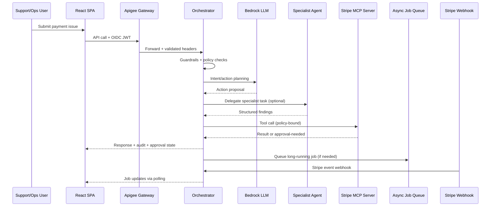

# Payments Ops Agent Study Notes (Workflow Deep Dive)

Use these notes to explain your system in an interview from edge request to external execution.

## 1) High-level architecture

- **SPA (React/Next.js)**: receives support/ops user input and displays agent outcomes.
- **Gateway (Apigee)**: validates inbound JWT, applies rate limits, injects audit headers, and can transform protocols.
- **Orchestrator Agent**: enforces policy, runs guardrails, asks the LLM for intent/action, then controls tool execution.
- **A2A Delegation Layer**: routes sub-tasks to specialist agents (reconciliation, payment-link drafting, refund analysis).
- **MCP Layer**: standardized tool invocation interface to Stripe and other systems.
- **External Systems**: Stripe APIs/webhooks, ticketing systems, notifications, and async workers.

## 2) Map to this codebase

- Main orchestrator path: `src/app/api/payments-ops/route.ts`
- Orchestration logic: `src/lib/payments-agent/orchestrator.ts`
- Gateway signal checks: `src/lib/payments-agent/apigee.ts`
- OIDC/JWT verification: `src/lib/payments-agent/auth.ts`
- Prompt/key defenses: `src/lib/payments-agent/security.ts`
- MCP policy + tool execution: `src/lib/payments-agent/mcp-stripe.ts`
- HITL approvals: `src/app/api/payments-ops/approval/route.ts`
- Async/webhook jobs: `src/app/api/webhooks/stripe/route.ts`, `src/app/api/payments-ops/jobs/[id]/route.ts`

## 3) End-to-end request workflow

1. **Step 1: User submits investigation** in SPA with bearer token.
2. **Step 2: Gateway validates** JWT and appends controls (`x-apigee-jwt-validated`, `x-request-id`, rate-limit headers).
3. **Step 3: Orchestrator authenticates** user and role (`support`/`ops`).
4. **Step 4: Guardrails run first**:
   - prompt injection checks,
   - secret redaction,
   - policy-bound prompt shaping.
5. **Step 5: LLM decisioning (Bedrock)** returns action intent (`investigate`, `reconcile`, `create_payment_link`, `refund`).
6. **Step 6: Tool proposal built** with strict allowlist + role checks.
7. **Step 7: HITL gate** is enforced for sensitive actions.
8. **Step 8: MCP tool call executes** against Stripe MCP server (or safe simulation) after approval.
9. **Step 9: Job is queued** and polled until completion for long operations.
10. **Step 10: Audit-rich response** is returned for traceability.

## 4) Gateway deep dive (what it does)

The gateway is your **policy enforcement point at ingress**.

Typical responsibilities:

- Step 1: JWT validation before app traffic reaches orchestrator.
- Step 2: Per-user/per-client rate limiting.
- Step 3: Request normalization (REST ↔ JSON-RPC transformations if needed).
- Step 4: Header injection for audit and distributed tracing.
- Step 5: Security controls (IP allowlist, bot filtering, payload limits).

Interview line:

- "The gateway is the front-door control plane; the orchestrator is the decision plane."

## 5) Orchestrator deep dive (what it does)

The orchestrator is the **brain + policy runtime**:

- Step 1: Accepts user objective.
- Step 2: Applies security guardrails.
- Step 3: Decides task strategy.
- Step 4: Delegates tasks.
- Step 5: Authorizes tools.
- Step 6: Requests human approvals.
- Step 7: Executes and summarizes outputs.

Interview line:

- "The orchestrator never grants tools directly from user intent; it converts intent into policy-checked tool plans."

## 6) A2A delegation layer (Agent-to-Agent)

Use this layer when one orchestrator should not contain all domain logic.

### Suggested specialists

- **Reconciliation Agent**: ledger mismatch analysis, settlement timing checks.
- **Troubleshooting Agent**: root-cause hypotheses + evidence retrieval.
- **Briefing Agent**: drafts incident/merchant update summary.
- **Payment Link Agent**: generates recovery link with constraints.

### Delegation contract

- Step 1: Orchestrator sends task with bounded context.
- Step 2: Specialist returns structured output + confidence + required actions.
- Step 3: Orchestrator merges outputs and decides next action.

### Minimal A2A payload shape

```json
{
  "taskId": "tsk_123",
  "delegatedBy": "payments-orchestrator",
  "specialist": "reconciliation-agent",
  "input": {
    "ticketId": "INC-10245",
    "paymentIntentId": "pi_123"
  },
  "constraints": {
    "maxTools": 2,
    "allowSensitiveActions": false
  }
}
```

## 7) MCP + tool call model

MCP gives you a normalized interface to tools (independent of provider SDK quirks).

In this repo, tool policy is enforced in `mcp-stripe.ts`:

- allowlisted tools only,
- role requirements by tool,
- sensitive actions require approval.

### Tool-call lifecycle

1. **Step 1:** LLM suggests an action.
2. **Step 2:** Orchestrator maps action to MCP tool proposal.
3. **Step 3:** Policy engine checks role + approval requirement.
4. **Step 4:** If approved/allowed, call MCP endpoint with strict args.
5. **Step 5:** Return structured result + audit metadata.

## 8) External systems map

- **Stripe**: payment status, links, refunds, events.
- **Webhook producer**: Stripe event pushes.
- **Serverless jobs**: async reconciliation and eventual completion updates.
- **Ticketing/CRM (future extension)**: attach evidence and final brief.

## 9) JSON-RPC deep dive (interview-friendly)

JSON-RPC is a lightweight protocol: `jsonrpc`, `id`, `method`, `params`, `result/error`.

### Why JSON-RPC for MCP/A2A

- Strong method contract (`method` name + typed `params`).
- Easy correlation (`id`) for tracing and retries.
- Works over HTTP, WebSocket, or internal queues.
- Cleaner for tool-style interactions than ad-hoc REST payloads.

### Example: Orchestrator -> MCP tool server

```json
{
  "jsonrpc": "2.0",
  "id": "req_9f2",
  "method": "tools/call",
  "params": {
    "name": "stripe.payment_links.create",
    "arguments": {
      "amount_cents": 1500,
      "currency": "usd",
      "customer_id": "cus_001"
    },
    "meta": {
      "requestId": "xreq-123",
      "actor": "ops_user_22"
    }
  }
}
```

Success response:

```json
{
  "jsonrpc": "2.0",
  "id": "req_9f2",
  "result": {
    "status": "ok",
    "tool": "stripe.payment_links.create",
    "data": {
      "payment_link_id": "plink_123",
      "url": "https://buy.stripe.com/test_123"
    }
  }
}
```

Error response:

```json
{
  "jsonrpc": "2.0",
  "id": "req_9f2",
  "error": {
    "code": -32001,
    "message": "Approval required",
    "data": {
      "approvalId": "apr_abc"
    }
  }
}
```

### Example: Orchestrator -> Specialist agent (A2A)

```json
{
  "jsonrpc": "2.0",
  "id": "a2a_455",
  "method": "agent/delegate",
  "params": {
    "agent": "reconciliation-agent",
    "input": {
      "ticketId": "INC-10245",
      "paymentIntentId": "pi_123"
    },
    "policy": {
      "toolsAllowed": ["stripe.payments.lookup"],
      "timeoutMs": 6000
    }
  }
}
```

## 10) Security model to memorize

- **Step 1 — Authentication**: OIDC token verification + issuer/audience constraints.
- **Step 2 — Authorization**: role-based tool access and action-level policy.
- **Step 3 — Prompt safety**: injection detection + sanitization.
- **Step 4 — Secret safety**: redaction before model/tool layers.
- **Step 5 — Human control**: approval gate for impactful operations.
- **Step 6 — Least privilege tools**: explicit allowlist, no dynamic raw tool names.
- **Step 7 — Auditability**: request IDs, gateway validation headers, tool decision trail.

## 11) Sequence diagram (talk-track)



## 12) Good interview framing

- "I split responsibilities into gateway control, orchestrator policy, and tool execution planes."
- "The agent never executes sensitive tools without explicit HITL approval."
- "I treat MCP as the stable contract for tool integrations and use JSON-RPC semantics for method safety and traceability."
- "A2A delegation keeps specialists focused and testable while the orchestrator owns risk and final decisions."
